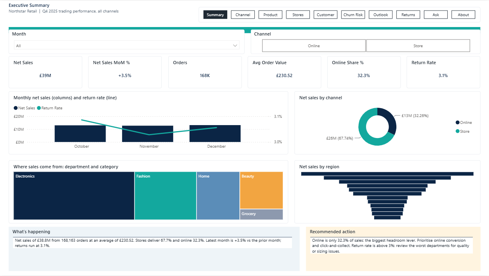
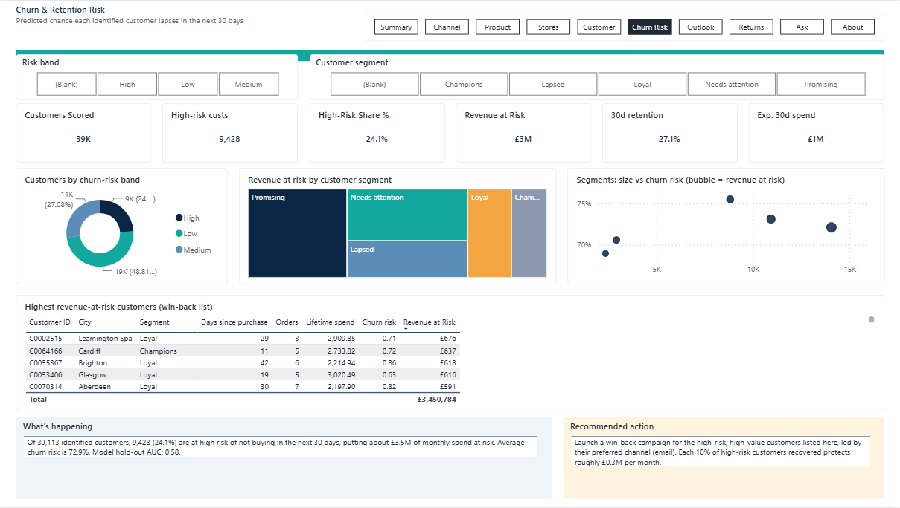
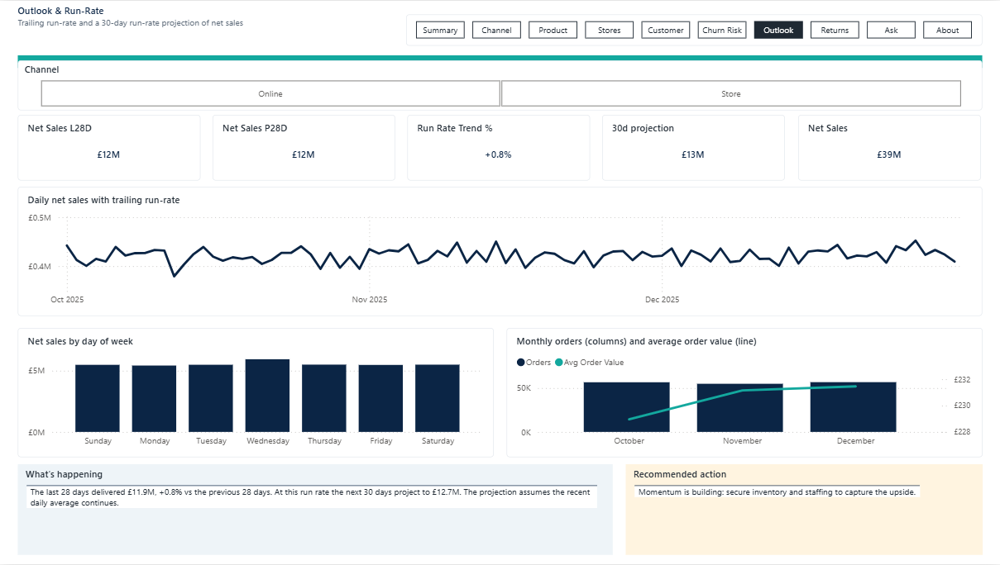
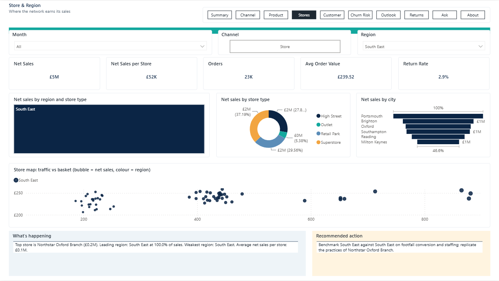
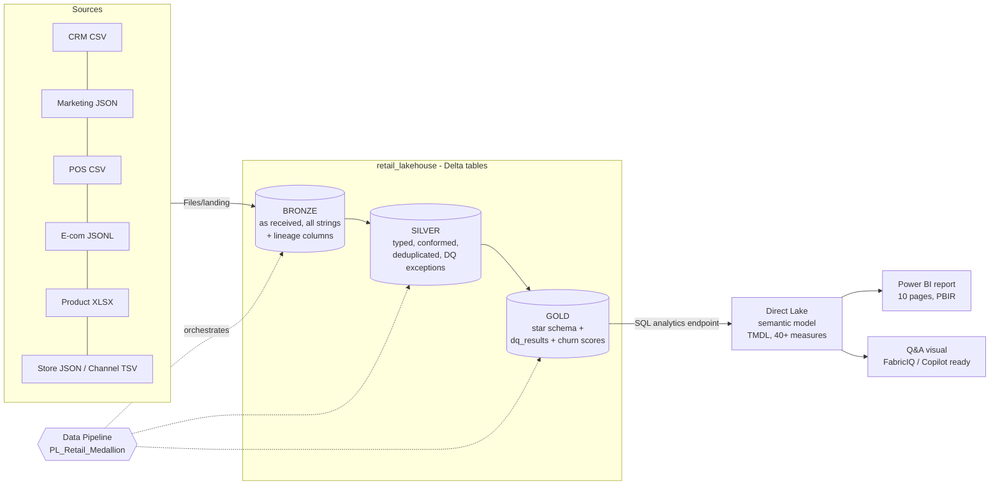

# Northstar Retail: an end-to-end Medallion Architecture on Microsoft Fabric

Messy retail files in, a governed star schema, a churn model and a 10-page consulting-grade Power BI report out.
Built in a single Fabric workspace using Lakehouse, Spark notebooks, a Data Pipeline, a Direct Lake semantic model and a hand-authored PBIR report.

> **Why this repo exists:** it is both a portfolio piece and a *learning manual*. Every decision is explained in `docs/` so you can rebuild the pattern on any dataset without leaning on AI.



| Churn & retention risk | Outlook |
|---|---|
|  |  |



## The problem

A (fictional) UK retailer, Northstar Retail, handed over five incompatible source systems for Q4 2025:

| Source | Format | Rows | Nature of the mess |
|---|---|---|---|
| CRM customers | CSV | 93,500 | duplicate customers, several ID formats, mixed date formats, future-dated updates |
| Marketing preferences | nested JSON | 83,000 | Y/N/true/1 consent flags, GDPR-deleted flags, orphans |
| POS transactions (2 parts) | CSV | 260,000 | 11 timestamp formats, currency symbols, VAT as `20%`/`0.2`/`zero`, return flags |
| E-commerce orders | JSON Lines (nested line items) | 70,000 orders, 153,389 lines | nested arrays, typos in status (`shippped`), cancelled lines |
| Product master | Excel | 8,180 | duplicate SKUs, 33% missing unit cost |
| Store master + channel lookup | JSON + TSV | 650 / 6 | legacy store codes, two schemas |

Source data and its generator: https://github.com/QuestionMarketing/Test-Retail-Data

## Architecture



| Layer | Notebook | Output tables | Rule of the layer |
|---|---|---|---|
| Bronze | `notebooks/01_bronze.py` | `bronze.*` (7 tables) | Never clean. Keep everything as received, add lineage, reconcile counts to the client inventory |
| Silver | `notebooks/02_silver.py` | `silver.*` (7 tables) + `dq_exceptions` | Parse, type, standardise keys, deduplicate, resolve entities |
| Gold | `notebooks/03_gold.py` | `dim_customer/product/store/date`, `fct_order_line`, `dq_results`, MLV | Business-ready star schema; every number reconciled |
| Gold (ML) | `notebooks/04_gold_churn.py` | `customer_churn_score` | Spark ML churn propensity per identified customer |

## Headline results

* **391,306** order lines, **£38.8M** net sales (Online 32% / Store 68%), 168K orders.
* **25 automated DQ and reconciliation checks, all PASS** (key uniqueness, referential integrity, net+VAT=gross, return sign, row and £ reconciliation across layers).
* Churn model: GBT classifier, hold-out **AUC about 0.58** (honestly reported, see `docs/05-churn-model.md`). 9,428 high-risk customers carrying about £3.45M monthly revenue at risk.
* Report: 10 pages, 140 visuals, dynamic "what's happening / recommended action" narratives under every page, 8 to 9 pt typography, month and channel slicers synced across pages.

## Repository map

```
notebooks/   PySpark notebooks (percent-cell .py, converted to Fabric notebooks by tools/build_nb.py)
tools/       Code generators: semantic model (TMDL), report (PBIR), pipeline JSON, deploy and lint scripts
docs/        The learning manual (start with docs/01-architecture-and-concepts.md)
docs/img/    Report screenshots
```

## Read in this order

1. [01 Architecture and concepts](docs/01-architecture-and-concepts.md): why medallion, why these tools
2. [02 Bronze and Silver walkthrough](docs/02-bronze-and-silver.md): the cleaning rules, line by line
3. [03 Gold and data quality](docs/03-gold-and-data-quality.md): star schema, surrogate keys, the 25 checks
4. [04 Semantic model and report](docs/04-semantic-model-and-report.md): Direct Lake, DAX, PBIR, narratives
5. [05 Churn model](docs/05-churn-model.md): features, leakage-safe labelling, evaluation, limits
6. [06 Pipeline, deployment and CLI](docs/06-pipeline-and-deployment.md): `fab`, REST API, gotchas
7. [07 Build-it-yourself playbook](docs/07-build-it-yourself-playbook.md): the checklist to repeat this on new data
8. [08 Limitations and lessons](docs/08-limitations-and-lessons.md): what is not perfect, and interview talking points

## Reproduce

Prerequisites: a Fabric workspace with a Lakehouse (`retail_lakehouse`), the [Fabric CLI](https://microsoft.github.io/fabric-cli/) (`fab auth login`), Python 3.10+.

1. Put the raw files under `Files/landing/{crm,stores,commerce,product,reference}` in the lakehouse (layout in `notebooks/01_bronze.py`).
2. Convert the `.py` sources to notebooks: `python tools/build_nb.py` (edit the workspace and lakehouse IDs at the top), then `fab import`.
3. Run notebooks 01 to 04 in order, or deploy and run the pipeline (`python tools/mkpl.py`).
4. Build and import the model: `python tools/mkmodel.py`, then `fab import ... .SemanticModel`.
5. Build and deploy the report: `python tools/mkreport2.py && python tools/lint.py && python tools/upd.py`.

The scripts contain the workspace and item IDs used in the original build. Replace them with your own.

## Honest limitations

Three months of data, no prior-year or targets, a modest churn signal, about a third of products without cost (so no margin), and a trial capacity that blocked the Fabric Data Agent. Full list in [docs/08](docs/08-limitations-and-lessons.md).
