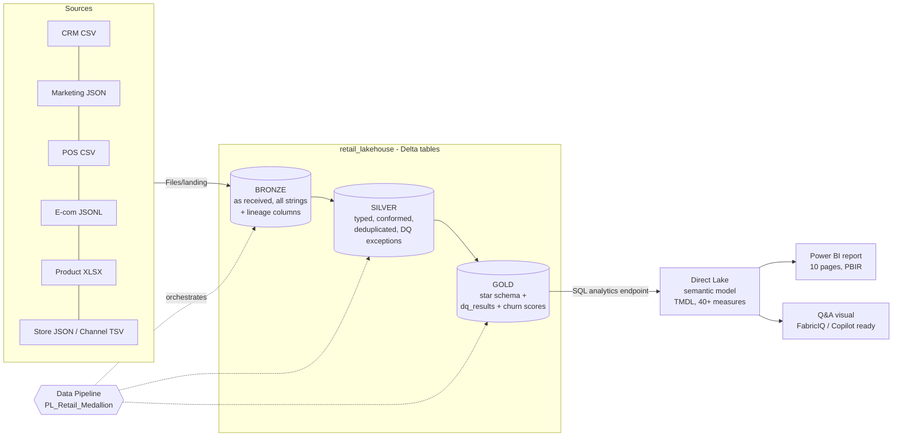

# Northstar Retail: an end-to-end Medallion Architecture on Microsoft Fabric

Messy retail files in, a governed star schema, a churn model and a 10-page consulting-grade Power BI report out.
Built in a single Fabric workspace using Lakehouse, Spark notebooks, a Data Pipeline, a Direct Lake semantic model and a hand-authored PBIR report.

> **Why this repo exists:** it is both a portfolio piece and a *learning manual*. Every decision is explained in `docs/` so you can rebuild the pattern on any dataset without leaning on AI.


| Churn & retention risk | Outlook |
|---|---|
|  |  |


## The problem

A (fictional) UK retailer, Northstar Retail, handed over five incompatible source systems for Q4 2025:

| Source | Format | Rows | Nature of the mess |
|---|---|---|---|
| CRM customers | CSV | 93,500 | duplicate customers, several ID formats, mixed date formats, future-dated updates |
| Marketing preferences | nested JSON | 83,000 | Y/N/true/1 consent flags, GDPR-deleted flags, orphans |
| POS transactions (2 parts) | CSV | 260,000 | 11 timestamp formats, currency symbols, VAT as `20%`/`0.2`/`zero`, return flags |
| E-commerce orders | JSON Lines (nested line items) | 70,000 orders, 153,389 lines | nested arrays, typos in status (`shippped`), cancelled lines |
| Product master | Excel | 8,180 | duplicate SKUs, 33% missing unit cost |
| Store master + channel lookup | JSON + TSV | 650 / 6 | legacy store codes, two schemas |

Source data and its generator: https://github.com/QuestionMarketing/Test-Retail-Data

## Architecture



| Layer | Notebook | Output tables | Rule of the layer |
|---|---|---|---|
| Bronze | `notebooks/01_bronze.py` | `bronze.*` (7 tables) | Never clean. Keep everything as received, add lineage, reconcile counts to the client inventory |
| Silver | `notebooks/02_silver.py` | `silver.*` (7 tables) + `dq_exceptions` | Parse, type, standardise keys, deduplicate, resolve entities |
| Gold | `notebooks/03_gold.py` | `dim_customer/product/store/date`, `fct_order_line`, `dq_results`, MLV | Business-ready star schema; every number reconciled |
| Gold (ML) | `notebooks/04_gold_churn.py` | `customer_churn_score` | Spark ML churn propensity per identified customer |

## Headline results

* **391,306** order lines, **£38.8M** net sales (Online 32% / Store 68%), 168K orders.
* **25 automated DQ and reconciliation checks, all PASS** (key uniqueness, referential integrity, net+VAT=gross, return sign, row and £ reconciliation across layers).
* Churn model: GBT classifier, hold-out **AUC about 0.58** (honestly reported). 9,428 high-risk customers carrying about £3.45M monthly revenue at risk.
* Report: 10 pages, 140 visuals, dynamic "what's happening / recommended action" narratives under every page, 8 to 9 pt typography, month and channel slicers synced across pages.

## Repository map

```
notebooks/   PySpark notebooks (Bronze, Silver, Gold, churn)
tools/       Generators for the semantic model, report and pipeline
docs/        Build-it-yourself playbook, screenshots, sample DQ results
```

[Build-it-yourself playbook](docs/07-build-it-yourself-playbook.md)
